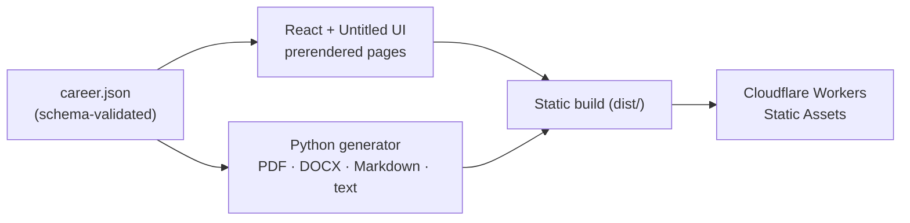
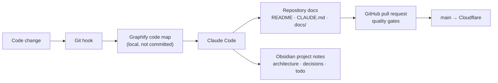

# Mohamed Moheyeldin — Portfolio Platform

[](https://mohamedmoheyeldin.com/)
[](https://github.com/mohamedmoheyeldin/portfolio/actions/workflows/ci.yml)


A Vite 8 portfolio with React 19, free Untitled UI components, Tailwind CSS v4, and a shared career record for the website and resume library.

## Status

The current portfolio includes Home, Experience with project and toolkit explorers, five case studies, and a resume library with PDF, Word, Markdown, and plain-text formats. The portfolio itself is featured as an independent engineering project.

`main` is the production branch for `https://mohamedmoheyeldin.com/`. Future Application Studio work belongs on `application-studio` and is not part of the current production release.

## Local setup

```bash
pnpm install --frozen-lockfile
pnpm verify
pnpm dev
```

Use Node.js 24 (see `.nvmrc`) and pnpm 11.22.0. The same commands work in Windows PowerShell and POSIX shells.

## Architecture



- `src/content/career.json` — canonical draft career facts
- `scripts/validate-content.mjs` — schema validation
- `src/styles/theme.css` — upstream Untitled UI theme
- `src/styles/global.css` — responsive portfolio layouts and typography
- `src/components/Portfolio.tsx` — React page composition and interactive work explorer
- `src/components/base/` — free Untitled UI source components

- `scripts/build.mjs` — canonical, social, icon, and structured metadata
- `docs/` — architecture, provenance, and open design brief

See [Architecture](docs/ARCHITECTURE.md), [Content provenance](docs/CONTENT_PROVENANCE.md), and [Design brief](docs/DESIGN_BRIEF.md).

See [Untitled UI integration](docs/UNTITLED-UI.md) for upstream attribution and local adaptations.

## Quality gates

```bash
pnpm check              # strict TypeScript diagnostics and content schema validation
pnpm build              # Static production output
pnpm test:pages         # GitHub Pages subpath packaging check
pnpm verify             # Complete local gate (alias for pnpm quality)
```

The quality gate validates TypeScript and content schemas, builds the site, and checks GitHub Pages subpath packaging. Browser test dependencies and suites have been removed. Navigation, filtering, downloads, responsive layouts, and accessibility require separate browser review.

See [Development](docs/DEVELOPMENT.md) and [Testing](docs/TESTING.md) for contributor workflow and test-layer details.

## How this project is maintained

Documentation is part of every change. The site is developed with an AI-assisted workflow that keeps the code, these docs, and my project notes in step.



| Tool | Role in this project |
|---|---|
| [Claude Code](https://claude.com/claude-code) | Development, reviews, and documentation updates, following [CLAUDE.md](CLAUDE.md). |
| [Graphify](https://pypi.org/project/graphifyy/) | A knowledge graph of the codebase, rebuilt by git hooks on every commit. Used to check what a change affects before editing. Output lives in `graphify-out/`, which is ignored by Git. |
| [Obsidian](https://obsidian.md) | Linked project notes: architecture summary, decisions with their reasons, and an open todo list, alongside my other projects. |
| [GitHub](https://github.com/mohamedmoheyeldin/portfolio) | Pull requests run the quality gates; merges to `main` deploy through Cloudflare. |

## Documentation map

| Document | Read it for |
|---|---|
| [Architecture](docs/ARCHITECTURE.md) | Content model, rendering, and the resume pipeline |
| [Development](docs/DEVELOPMENT.md) | Setup, daily workflow, and source boundaries |
| [Testing](docs/TESTING.md) | Quality gates and what they cover |
| [Content provenance](docs/CONTENT_PROVENANCE.md) | Where career facts come from and what may be published |
| [Design brief](docs/DESIGN_BRIEF.md) | Visual direction |
| [Untitled UI](docs/UNTITLED-UI.md) | Upstream components and local adaptations |
| [Cloudflare](docs/CLOUDFLARE.md) | Production hosting and deployment |
| [Dependencies](docs/DEPENDENCIES.md) | Why each dependency is here |

## Deployment

Cloudflare Workers Static Assets is the production host. Pushes to `main` are built through Cloudflare's Git integration. Use `pnpm run build:cloudflare` and `pnpm dlx wrangler@4.144.0 deploy` in Cloudflare's build settings. See [Cloudflare deployment](docs/CLOUDFLARE.md).
