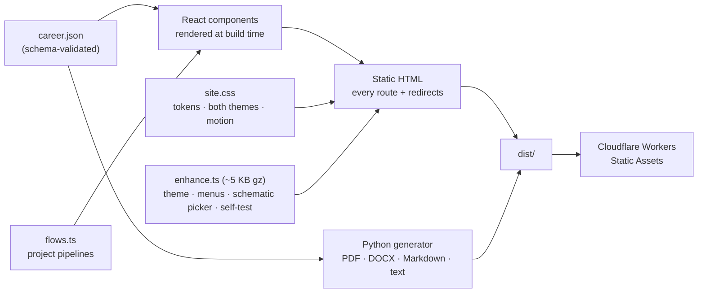
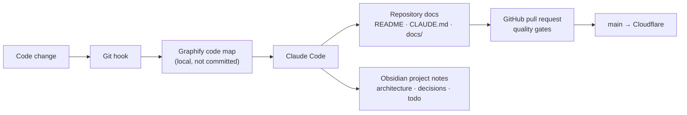

# Mohamed Moheyeldin — Portfolio Platform

[](https://mohamedmoheyeldin.com/)
[](https://github.com/mohamedmoheyeldin/portfolio/actions/workflows/ci.yml)
-149ECA?logo=react&logoColor=white)


> [!NOTE]
> A statically rendered portfolio set as a deck of case files: the featured projects stack like folders as you scroll, and every case you pass leaves its tab behind as an index. One schema-validated career record drives the site and every resume format.

## Status

Home (full-bleed acts alternating near-black and bone, headlines in capitals at poster scale and one coral string drawn down the page as you read, after an intro where the signature writes itself: the claim; a statement; a running, pickable diagram of the documented VA claim-status design; six project scenes, each a giant word with paper cards restating its result; the career on a bar drawn to scale; what I bring; the close, where the string arrives as a knot and pulls into a check mark), Experience (every role and highlight, project register, skills, credentials, education), six case studies (the portfolio one carries the page self-test), and a resume library in PDF, Word, Markdown and plain text. Light and dark themes are designed separately. The October 30, 2026 thread redesign is on the `newAI` branch (the signal redesign before it is on `NewIU`); see [the design brief](docs/DESIGN_BRIEF.md) and [the Scrollcraft brief](docs/SCROLLCRAFT-BRIEF.md).

`main` is the production branch for `https://mohamedmoheyeldin.com/`. Future Application Studio work belongs on `application-studio` and is not part of the current production release.

## Architecture



- `src/content/career.json` — canonical career facts, validated by `scripts/validate-content.mjs`
- `src/content/flows.ts` — the three project pipelines, each station restating a documented field
- `src/components/site/` — `layout.tsx` (header, close, footer), `home.tsx`, `experience.tsx`, `case-study.tsx`, `ui.tsx` (icons, resume popover, evidence tag, the hero schematic, pipeline), `shared.tsx` (links and derived helpers)
- `src/lib/selftest.ts` — the 16 page checks; `src/client/enhance.ts` — the only script the site ships
- `src/styles/site.css` — the design system: tokens, both themes, the acts and the thread, the schematic, the project scenes and their papers, components, motion
- `scripts/build.mjs` — prerendering, metadata, structured data, sitemap and legacy redirects

React renders pages at build time only. The published site ships no framework: the browser loads one small module for the theme switch, menus, copy buttons, the current section, the schematic picker and the self-test. Menus use the native popover API and long detail uses `<details>`, so they work without JavaScript.

## Setup and commands

```bash
pnpm install --frozen-lockfile
pnpm dev
pnpm verify
```

Use Node.js 24 (see `.nvmrc`) and pnpm 11.22.0. The same commands work in Windows PowerShell and POSIX shells.

| Task | Command |
|---|---|
| Dev server (port 4322, no browser opened) | `pnpm dev` |
| Types and content schema | `pnpm check` |
| Full local gate | `pnpm verify` |
| Production build for Cloudflare | `pnpm build:cloudflare` |
| Regenerate every resume format | `pnpm resume:generate` |

`pnpm verify` ends with the `/portfolio/` subpath build; run `pnpm build` (or `pnpm build:cloudflare`) before previewing `dist`. Browser checks (Playwright functional suite, axe-core WCAG 2.2 AA, Lighthouse, the Scrollcraft scroll harness) run headless from the Scrollcraft workspace outside this repo. Results and limits are in [Testing](docs/TESTING.md).

## How this project is maintained

Documentation is part of every change. The site is developed with an AI-assisted workflow that keeps the code, these docs, and my project notes in step.



| Tool | Role in this project |
|---|---|
| [Claude Code](https://claude.com/claude-code) | Development, reviews, and documentation updates, following [CLAUDE.md](CLAUDE.md). |
| [Graphify](https://pypi.org/project/graphifyy/) | A knowledge graph of the codebase, rebuilt by git hooks on every commit. Output lives in `graphify-out/`, which is ignored by Git. |
| [Obsidian](https://obsidian.md) | Linked project notes: architecture summary, decisions with their reasons, and an open todo list. |
| [GitHub](https://github.com/mohamedmoheyeldin/portfolio) | Pull requests run the quality gates; merges to `main` deploy through Cloudflare. |
| [Scrollcraft](https://github.com/nateherkai/scroll-craft) | Design process (brief, grammar, feeling curve, signature move, fingerprint gate) and the scroll-verification harness. Installed once per machine as a personal Claude Code skill; nothing from it ships in the site. |

## Documentation map

| Document | Read it for |
|---|---|
| [Architecture](docs/ARCHITECTURE.md) | Rendering, the enhancement script, tokens, the resume pipeline |
| [Design brief](docs/DESIGN_BRIEF.md) | Visual direction, type, colour, motion |
| [Scrollcraft brief](docs/SCROLLCRAFT-BRIEF.md) | Grammar, journey, feeling curve, score, signature move, fingerprint gate |
| [Development](docs/DEVELOPMENT.md) | Setup, daily workflow, source boundaries |
| [Testing](docs/TESTING.md) | Quality gates and browser results, with what they do not cover |
| [Content provenance](docs/CONTENT_PROVENANCE.md) | Where career facts come from and what may be published |
| [Cloudflare](docs/CLOUDFLARE.md) | Production hosting and deployment |
| [Dependencies](docs/DEPENDENCIES.md) | Why each dependency is here |

## Deployment

Cloudflare Workers Static Assets is the production host. Pushes to `main` are built through Cloudflare's Git integration with `pnpm run build:cloudflare` and deployed with `pnpm dlx wrangler@4.144.0 deploy`. See [Cloudflare deployment](docs/CLOUDFLARE.md).
