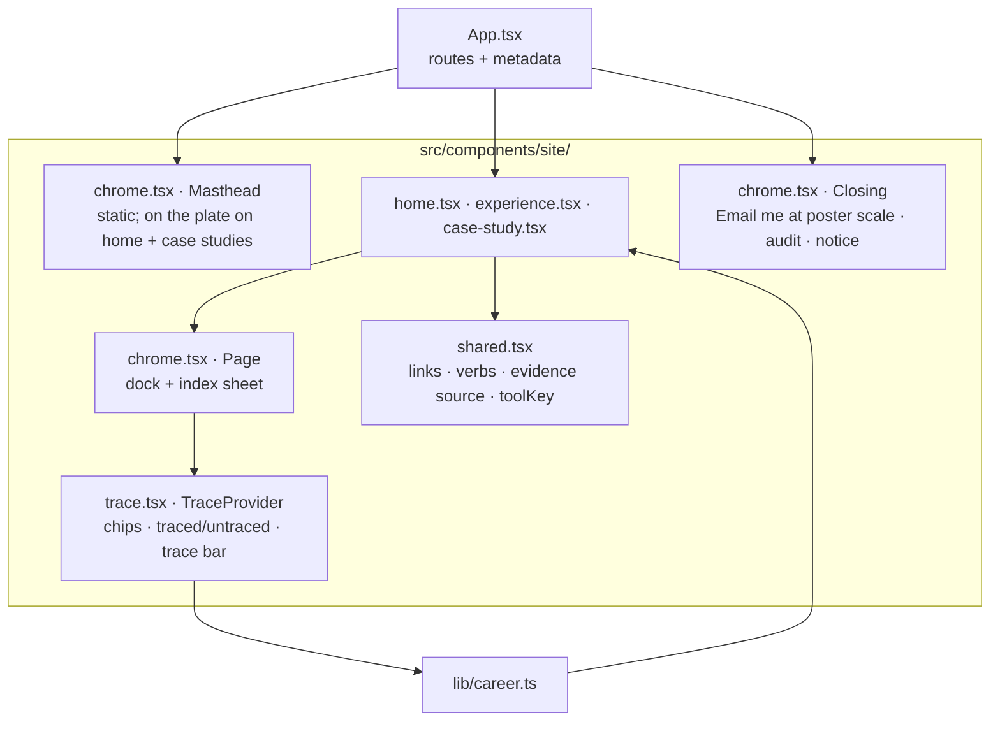

# Portfolio platform architecture

The canonical `/experience/` page combines projects and employment context with professional approach, skills, and education. The former `/about/` page is a compatibility redirect, excluded from the sitemap. Its generated redirect preserves query strings and fragments with JavaScript and includes a no-JavaScript refresh and link. Individual project routes remain available.

## Purpose

This repository is one personal-brand system with three presentation channels:

1. a semantic, prerendered React website;
2. a searchable PDF resume produced with ReportLab;
3. an editable Word resume produced by a dedicated DOCX renderer.

All channels must consume the same schema-validated career record. They can select, order, and format facts for their medium, but cannot maintain separate copies of career history.

## Baseline boundaries

The shared masthead contains personal branding, primary navigation, the theme toggle, the resume menu and "Email me". It is static (not fixed); once the opening section has scrolled away, the dock (index and "Email me", bottom right) takes over navigation. The live experience clock was removed at the user’s request; there is no ticking interval or date-duration display.

- Vite 8.x, React 19, strict TypeScript, semantic HTML, and Tailwind CSS v4.
- Static output for Cloudflare Workers Static Assets and the custom domain.
- Free Untitled UI React components supply buttons and links, a utility copy button with tooltip, the resume dropdown, the slide-out index sheet, navigation items, tabs, badges, social icons, icons, and theme tokens. The trace chips are native toggle buttons (`aria-pressed`) and the long detail uses native `
`. Components render to static HTML through React server rendering at build time. The application hydrates after static HTML loads; the Experience page uses React state for project and detail-section selection, with hash links and browser history support. See `UNTITLED-UI.md` for the component inventory and source adaptations.
- `src/components/Portfolio.tsx` is the composition entry; the pages live in `src/components/site/` (see "Poster redesign" below). Routes retain static content collection reads, route generation, and page metadata. There is no client router or application server.
- Automated validation in the repo covers TypeScript diagnostics, content schemas, production builds, and subpath packaging. Browser, accessibility and performance checks run from the Scrollcraft workspace outside the repo (see `TESTING.md`); no browser test framework is a project dependency.
- The standalone Python resume generator reads the same career JSON and renders PDF and DOCX downloads.

## Project storytelling

Work projects reference a canonical experience ID. The Experience page shows that employer, role, and end customer in the project's detail panel. Independent work has no employer association. Schema validation rejects missing or invalid work-to-experience references.

Career-derived projects are stored beside the canonical career record and rendered through static detail routes. Their challenge, approach, outcome, toolkit, and disclosure fields are schema-validated. The project layer may reorganize documented responsibilities into a clearer narrative, but it cannot invent metrics or expose client-sensitive details.

Independently shareable case-study routes own their page-specific title and description and intentionally omit the site-wide social image when no project-specific primary image exists.

## Design flexibility

The web presentation is the typographic poster described in `DESIGN_BRIEF.md`: upstream Untitled UI tokens and components, blue as the one hue (used as a ground on the plate as well as an accent), self-hosted Archivo and Inter. Layout styles live in `src/styles/global.css`; upstream semantic tokens live in `src/styles/theme.css`. PDF and DOCX generation resolves the light-theme text and brand colors from these same tokens, with Inter and print-specific type sizes.

## Document pipeline

`career.json` → `scripts/generate-resumes.py` → PDF / DOCX downloads

The repository publishes one-page and detailed PDF/DOCX artifacts from the canonical content source through the dedicated resume generator. Web, PDF, and Word may format and select facts differently, but career history remains owned by the shared record. The site has no separate Resume page: the masthead and hero "Resume" buttons and the closing plate's PDF and Word links each open a menu (the index sheet lists both PDFs) to choose the one-page or detailed version (without JavaScript they link to the detailed file), and `/resume/` redirects to the detailed PDF for older links.

Case studies also validate audience, systems, decisions, evidence links, and FDE relevance. Evidence distinguishes user-reported career results from public source code. The portfolio walkthrough documents static rendering and explicitly states that no runtime API or database exists.

Resume generation also regenerates concise/detailed Markdown and job-board plain text to keep downloadable formats aligned. Compact highlights select existing facts; the portfolio project uses its canonical resumeSummary.

### Work explorer presentation

The Experience introduction is followed by a compact credential strip before the professional experience heading. `src/content/credential-images.json` maps canonical credential verification links to the user's exact official Accredible image URLs and verified intrinsic dimensions. The existing content check validates image URLs and canonical references. A responsive grid displays seven or five previews per row on wide screens and becomes a single swipeable row on narrow screens so the strip stays short before the work; each 4:3 image area uses `object-fit: contain` to preserve the complete badge or certificate. The strip uses ordinary images with alt text, lazy loading and async decoding, and requires no iframe or JavaScript scaling. Readable titles, year-only issue captions and verification links accompany each image. The Learning section shows credential titles, issuers, issue years and verification links. Expiration dates are retained as canonical facts but omitted from the portfolio's own listings and all resume formats; the issuer's unaltered certificate image contains its original issue/expiration details. Static text, images and links remain usable without JavaScript. This presentation mapping is separate from shared career facts and resume generation.

The project selector is a numbered menu (matching the home register's order) beside one detail panel from 1000px, and a scrolling row above it on narrower screens. Embedded case studies show the employer, historical role, dates, and customer once. Three controls group the full content into Overview (problem and results), Implementation (contribution, systems, tools, and walkthrough), and Evidence. Disclosure notes remain visible in all three views. Direct project routes and server-rendered content remain available without JavaScript.

Legacy `/work/` and `/work/<project>/` URLs redirect to the corresponding `/experience/` URLs, preserving query and fragment. `/about/` redirects to `/experience/`. Only canonical Experience routes appear in navigation and the sitemap.

## Poster redesign (October 30, 2026)

The third Scrollcraft build on `NewIU`: a typographic poster. It replaces the editorial build (folio, reading-depth control, colophon); that build stays in git history and in the Scrollcraft fingerprint registry.

- **Component organization.** `site/shared.tsx` holds links, the project display name and verb, the derived evidence source and `toolKey`. `site/chrome.tsx` holds the masthead, `Page` (section tracking, the dock and its index sheet), `ResumeMenu`, `CopyEmail` and `Closing`. `site/trace.tsx` holds the trace context, `TraceChip`, `useTraceState` and the trace bar. `site/home.tsx` holds the poster, Facts, the home sections and the shared `ChapterOpener` and `CareerChapter`. `site/experience.tsx` and `site/case-study.tsx` are as before, restyled. `Portfolio.tsx` re-exports them and owns the 404 page.
- **The trace (the signature move).** One piece of React state, `{ key, name } | null`, provided by `Page`. `TraceChip` renders a plain `` until hydration, then a toggle `<button aria-pressed>`; server and first client render match, so there is no hydration mismatch. Spreads and roles call `useTraceState(tools)` and set `data-trace="traced" | "untraced"`; CSS draws the accent edge and dims the rest. The bar is an `aside` with jump links, a close button and an `aria-live` summary; Esc clears it. Tool names match case-insensitively (`toolKey`).
- **Tokens.** Portfolio aliases on top of the upstream tokens in `global.css`: `--pf-ground`, `--pf-band`, `--pf-surface`, `--pf-ink`, `--pf-ink-soft`, `--pf-rule`, `--pf-rule-strong`, `--pf-accent`, `--pf-plate`, `--pf-plate-ink`, `--pf-plate-soft`, `--pf-plate-rule`, `--pf-shadow`, `--pf-display`, `--pf-ease`, `--pf-gutter`, `--pf-section`, `--pf-measure`, `--pf-dock`. Dark values are set on `.dark-mode`. `.plate` restates the Untitled UI semantic tokens and their utility aliases (`--text-color-*`, `--background-color-*`, which otherwise resolve once at `:root`) so components inside it render white-on-blue; tertiary controls there use the unlayered `.plate .plate-ghost` rule.
- **Grounds.** Sections change ground by hard cut: ground (white / blue-black), band (cool grey / raised navy-grey) for How the work is checked, Stack and the Experience bands, and the plate (cobalt / deep navy) at the open and close.
- **Motion.** Native CSS in one block at the end of `global.css`: the two halves of the name slide in from opposite edges (painted at once, so the LCP is not delayed), the hero copy rises, the wordmark recedes slightly as the poster scrolls away, each project verb wipes in on a `view()` timeline, the evidence rules and the pipeline figure draw, each habit is at full ink only while it crosses the middle of the screen, the role years wipe in, the stack settles, and cross-document view transitions. All of it is inside `prefers-reduced-motion: no-preference`; scroll-driven parts are also inside `@supports (animation-timeline: view())`. Keyframes avoid `translate: none` (WebKit bug 327193). The result panels and role years are `position: sticky` on wide screens.
- **Fonts.** Self-hosted Latin WOFF2 subsets in `src/assets/fonts/` (Archivo variable, weight 500 to 800 and width 62 to 125%; Inter variable), preloaded from `index.html`, with local fallback faces. The display lines are single `nowrap` lines, so the swap cannot rewrap them; measured CLS is 0 (see `TESTING.md`).
- **Scrollcraft hooks.** Sections carry `data-sc-act` with their device name (`kinetic`, `reveal`, `focus`, `draw`, `trace`, `plate`) and `Page` adds `html.sc-ready` after mount. They have no runtime effect; they let the skill's `shoot.mjs` harness find the acts.