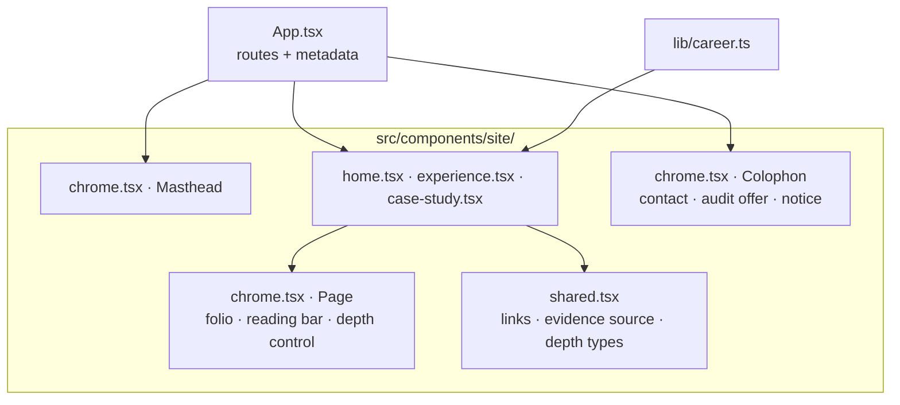

# Portfolio platform architecture

The canonical `/experience/` page combines projects and employment context with professional approach, skills, and education. The former `/about/` page is a compatibility redirect, excluded from the sitemap. Its generated redirect preserves query strings and fragments with JavaScript and includes a no-JavaScript refresh and link. Individual project routes remain available.

## Purpose

This repository is one personal-brand system with three presentation channels:

1. a semantic, prerendered React website;
2. a searchable PDF resume produced with ReportLab;
3. an editable Word resume produced by a dedicated DOCX renderer.

All channels must consume the same schema-validated career record. They can select, order, and format facts for their medium, but cannot maintain separate copies of career history.

## Baseline boundaries

The shared masthead contains personal branding, primary navigation, the theme toggle, the resume menu and "Email me". It is static (not fixed); on wide screens the folio takes over navigation as the page scrolls. The live experience clock was removed at the user’s request; there is no ticking interval or date-duration display.

- Vite 8.x, React 19, strict TypeScript, semantic HTML, and Tailwind CSS v4.
- Static output for Cloudflare Workers Static Assets and the custom domain.
- Free Untitled UI React components supply buttons and links, a utility copy button with tooltip, the resume dropdown, the slide-out contents sheet, navigation items, tabs, badges, social icons, icons, and theme tokens. The reading-depth control is a React Aria `RadioGroup`. Components render to static HTML through React server rendering at build time. The application hydrates after static HTML loads; the Experience page uses React state for project and detail-section selection, with hash links and browser history support. See `UNTITLED-UI.md` for the component inventory and source adaptations.
- `src/components/Portfolio.tsx` is the composition entry; the pages live in `src/components/site/` (see "Editorial redesign" below). Routes retain static content collection reads, route generation, and page metadata. There is no client router or application server.
- Automated validation in the repo covers TypeScript diagnostics, content schemas, production builds, and subpath packaging. Browser, accessibility and performance checks run from the Scrollcraft workspace outside the repo (see `TESTING.md`); no browser test framework is a project dependency.
- The standalone Python resume generator reads the same career JSON and renders PDF and DOCX downloads.

## Project storytelling

Work projects reference a canonical experience ID. The Experience page shows that employer, role, and end customer in the project's detail panel. Independent work has no employer association. Schema validation rejects missing or invalid work-to-experience references.

Career-derived projects are stored beside the canonical career record and rendered through static detail routes. Their challenge, approach, outcome, toolkit, and disclosure fields are schema-validated. The project layer may reorganize documented responsibilities into a clearer narrative, but it cannot invent metrics or expose client-sensitive details.

Independently shareable case-study routes own their page-specific title and description and intentionally omit the site-wide social image when no project-specific primary image exists.

## Design flexibility

The web presentation is the editorial edition described in `DESIGN_BRIEF.md`: upstream Untitled UI tokens and components, blue as the only accent, self-hosted Inter and Newsreader. Layout styles live in `src/styles/global.css`; upstream semantic tokens live in `src/styles/theme.css`. PDF and DOCX generation resolves the light-theme text and brand colors from these same tokens, with Inter and print-specific type sizes.

## Document pipeline

`career.json` → `scripts/generate-resumes.py` → PDF / DOCX downloads

The repository publishes one-page and detailed PDF/DOCX artifacts from the canonical content source through the dedicated resume generator. Web, PDF, and Word may format and select facts differently, but career history remains owned by the shared record. The site has no separate Resume page: the masthead, title-page and folio "Resume" buttons and the colophon's PDF and Word links each open a menu (the phone contents sheet lists both files) to choose the one-page or detailed version (without JavaScript they link to the detailed file), and `/resume/` redirects to the detailed PDF for older links.

Case studies also validate audience, systems, decisions, evidence links, and FDE relevance. Evidence distinguishes user-reported career results from public source code. The portfolio walkthrough documents static rendering and explicitly states that no runtime API or database exists.

Resume generation also regenerates concise/detailed Markdown and job-board plain text to keep downloadable formats aligned. Compact highlights select existing facts; the portfolio project uses its canonical resumeSummary.

### Work explorer presentation

The Experience introduction is followed by a compact credential strip before the professional experience heading. `src/content/credential-images.json` maps canonical credential verification links to the user's exact official Accredible image URLs and verified intrinsic dimensions. The existing content check validates image URLs and canonical references. A responsive grid displays seven or five previews per row on wide screens and becomes a single swipeable row on narrow screens so the strip stays short before the work; each 4:3 image area uses `object-fit: contain` to preserve the complete badge or certificate. The strip uses ordinary images with alt text, lazy loading and async decoding, and requires no iframe or JavaScript scaling. Readable titles, year-only issue captions and verification links accompany each image. The Learning section shows credential titles, issuers, issue years and verification links. Expiration dates are retained as canonical facts but omitted from the portfolio's own listings and all resume formats; the issuer's unaltered certificate image contains its original issue/expiration details. Static text, images and links remain usable without JavaScript. This presentation mapping is separate from shared career facts and resume generation.

The project selector is a numbered menu (1.1 to 1.6, matching the home entries) beside one detail panel from 1000px, and a scrolling row above it on narrower screens. Embedded case studies show the employer, historical role, dates, and customer once. Three controls group the full content into Overview (problem and results), Implementation (contribution, systems, tools, and walkthrough), and Evidence. Disclosure notes remain visible in all three views. Direct project routes and server-rendered content remain available without JavaScript.

Legacy `/work/` and `/work/<project>/` URLs redirect to the corresponding `/experience/` URLs, preserving query and fragment. `/about/` redirects to `/experience/`. Only canonical Experience routes appear in navigation and the sitemap.

## Editorial redesign (October 30, 2026)

- **Component organization.** `site/shared.tsx` holds links, the project display name, the derived evidence source and the depth definitions. `site/chrome.tsx` holds the masthead, `Page` (folio and reading bar), `DepthControl`, `DepthNote`, `ResumeMenu`, `CopyEmail` and the `Colophon`. `site/home.tsx` holds the title page, the four home chapters and the shared `ChapterOpener` and `CareerChapter`. `site/experience.tsx` holds the Experience page, the project and toolkit explorers, the credential strip and Learning. `site/case-study.tsx` holds the standalone and embedded case study and the pager. `Portfolio.tsx` re-exports them and owns the 404 page.
- **Reading depth (the signature move).** `html[data-read]` is `brief`, `standard` (default) or `full`. Blocks carry `data-detail="standard"` or `"full"`; one CSS rule hides them below the chosen depth. The inline script in `index.html` sets the saved depth before first paint, so there is no flash and no hydration mismatch (React never renders the attribute). Changing depth keeps the block nearest the top of the screen in place (blocks marked `data-anchor`), then corrects once more after React re-renders. Without JavaScript no depth is set and every block renders.
- **Tokens.** Portfolio aliases on top of the upstream tokens in `global.css`: `--pf-ground`, `--pf-surface`, `--pf-ink`, `--pf-ink-soft`, `--pf-rule`, `--pf-rule-strong`, `--pf-accent`, `--pf-edge`, `--pf-serif`, `--pf-ease`, `--pf-gutter`, `--pf-section`, `--pf-measure`, `--pf-margin`, `--pf-folio-bar`. The dark values are set on `.dark-mode`, so always-dark regions (the colophon) pick them up too. Untitled UI maps `text-brand-secondary` to a neutral in dark mode, so the dark accent is `brand-300` directly.
- **Motion.** Native CSS in one block at the end of `global.css`: a title-page entrance (the headline itself is not animated, so it paints as the LCP element at once), evidence rules and the pipeline figure drawn on `view()` timelines, method stages settling in, career years drifting at a slower rate, a scroll progress line in the folio, and cross-document view transitions. All of it is inside `prefers-reduced-motion: no-preference`; scroll-driven parts are also inside `@supports (animation-timeline: view())`. Keyframes avoid `translate: none` (WebKit bug 327193).
- **Fonts.** Self-hosted Latin WOFF2 subsets in `src/assets/fonts/`, preloaded from `index.html`, with metric-matched local fallback faces (`Inter Fallback`, `Newsreader Fallback`) so the swap does not shift layout.
- **Scrollcraft hooks.** Chapters carry `data-sc-act` with their device name and `Page` adds `html.sc-ready` after mount. They have no runtime effect; they let the skill's `shoot.mjs` harness find the acts.
