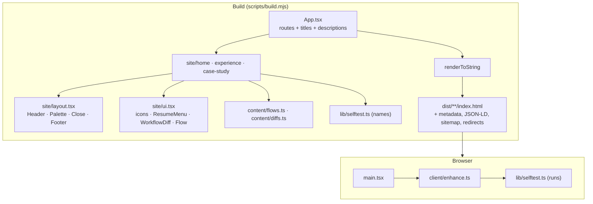

# Portfolio platform architecture

## Purpose

One personal-brand system with three presentation channels:

1. a semantic, statically rendered website;
2. a searchable PDF resume produced with ReportLab;
3. an editable Word resume produced by a dedicated DOCX renderer.

All channels consume the same schema-validated career record (`src/content/career.json`). They may select, order and format facts for their medium, but never keep separate copies of career history.

## Rendering: React at build time, no framework in the browser

- `scripts/build.mjs` runs the Vite client build, then loads `src/entry-server.tsx` through Vite's SSR loader and writes every route, `404.html`, the sitemap, `robots.txt` and the legacy redirects. Each page carries its title, description, canonical, Open Graph tags and, on home, `ProfilePage` JSON-LD.
- `src/main.tsx` imports the stylesheet and `client/enhance.ts`. In development only (there is no prerender step under `pnpm dev`) it first renders `App` with React; that branch sits behind `import.meta.env.DEV`, so production bundles contain no React. Production JavaScript is about 15 KB (under 6 KB gzipped).
- `client/enhance.ts` adds: the theme toggle (system by default, a saved choice overrides, `theme-color` follows, View Transitions crossfade when motion is allowed); copy-address buttons; the current section marked in the header; closing menus after a jump and placing them under their button where CSS anchor positioning is missing; a plain-link fallback where the popover API is missing; the command palette; the Before / Diff / After views and paired-line highlighting on workflow diffs; Core Web Vitals observers; the self-test runner; and `html.sc-ready` for the Scrollcraft harness.
- Without JavaScript every page is complete: content, links, the resume and phone menus (native `popover`), `
` disclosures and the contact links all work. JS-only controls (`.js-only`: the palette button, theme toggle, diff view control, copy buttons, the self-test button) are hidden; diffs show in full; the self-test states that it needs JavaScript.
- The theme is applied before first paint by an inline script in `index.html` (`html.dark-mode`, saved in `localStorage` as `theme`).

## Workflow diffs (signature move)

`src/content/diffs.ts` holds before/after pairs per project. Every line restates a documented field (`challenge` for before; `outcome`, `approach` or `metric` for after; the source is commented per pair) and each diff carries a note on where its evidence comes from. `WorkflowDiff` in `ui.tsx` renders it as a `figure` with an ordered list of removed and added lines (screen readers hear "Before:" and "After:"). `enhance.ts` adds a Before / Diff / After button group (`aria-pressed`) that sets `data-view` on the figure, and outlines the paired line on pointer hover.

## Command palette

`Palette` in `layout.tsx` renders a native `<dialog>` with a combobox input and a listbox of every section, project, role, skill group, resume file and contact action, built from the career record at build time (each option carries its search text). `enhance.ts` opens it from the header button, Ctrl K or ⌘K, or "/", filters by every typed word, moves the active option with the arrow keys (`aria-activedescendant`), opens it on Enter or click, and returns focus on close. Without JavaScript the button is hidden and the header links cover the same routes.

## The page self-test

Shown on the Portfolio & Career Content System case study (`#selftest`) and linked from every footer. `src/lib/selftest.ts` exports 16 checks, each `{ id, name, run }`. The server render lists their names; `enhance.ts` runs them in order when the visitor presses "Run the checks", writing the result and measured value into each row and a summary into a `role="status"` line. Every check reads the live page: heading order, image alt text, accessible names of links and buttons, duplicate ids, in-page link targets, HTTPS on external links, `HEAD` requests to the four resume files, WCAG contrast of every ink token on every ground token in the current theme, horizontal overflow, 24 px target size, a walk of the stylesheets confirming every animation sits inside `prefers-reduced-motion: no-preference` (and, with reduced motion on, that none run), the theme against the saved or system choice, language/title/description/canonical, transferred bytes from Resource Timing, layout shift and LCP from `PerformanceObserver`. Checks a browser cannot measure (LCP and CLS outside Chromium) report "not measurable here" rather than passing.

## Project storytelling

Work projects reference an experience ID; case studies show employer, role, dates and end customer. Every project carries a workflow diff (above). The three featured projects also carry a diagram from `src/content/flows.ts`: an ordered list of steps plus side notes, each restating a documented `approach` or `systems` entry (the source index is commented beside each step) and captioned as a diagram of the documented design. The evidence label on every result (User-reported, Public source, Documented responsibility) is derived from the record by `evidenceSource()`, never typed.

## Design system

`src/styles/site.css`, in cascade layers `tokens, base, layout, components, motion`:

- **Tokens.** Grounds (`--paper`, `--grid` for tinted bands, `--surface`, `--surface-2`), ink (`--ink`, `--ink-2`, `--ink-3`), lines (`--line`, `--line-strong`, `--grid-line`), one vermilion accent in two lightnesses (`--accent` with hover, ink, soft and line), meaning colours (`--add`, `--del` and their soft grounds for diffs; `--pass`, `--fail` for checks), the contact plate (`--plate*`, always dark; the plate rescopes the ink and surface tokens locally), three elevations and an edge light, type scale with `clamp()`, a 4px space scale, radii and easing. All colours are hex so print tooling and the self-test read them directly. `:root.dark-mode` redefines them; dark also sets type slightly heavier and looser.
- **Layout.** `.wrap` (78rem plus gutters), `.section` and `.section--tint` bands, `.section-head` (with a two-column `--split` variant), and per-component grids that collapse to one column on phones.
- **Components.** Buttons (`.btn`, primary, quiet, icon, small, large), popover menus, the header and search button, the command palette, hero, status pill and working loop, work index, featured project and compact row, the workflow diff, flow diagram, career timeline, practices and toolkit, the contact plate and its routes, the audit offer, footer, page heads with a table of contents or fact sheet, case-study parts, steps, project table, credential grid and self-test panel.
- **Motion.** Native CSS in the `motion` layer, entirely inside `prefers-reduced-motion: no-preference`; scroll-driven parts also inside `@supports (animation-timeline: view())`. The resting state is the visible state. See the design brief.

## Document pipeline

`career.json` → `scripts/generate-resumes.py` → PDF / DOCX / Markdown / job-board text in `public/resume/`.

The generator reads the light-theme `--ink`, `--ink-3` and `--accent` hex tokens from `src/styles/site.css` for print colour, with Inter from `assets/fonts` and print-specific sizes. There is no Resume page: resume buttons open a popover with the one-page and full resume in PDF and Word, the close lists all four files as links, and `/resume/` redirects to the detailed PDF for older links.

## Routes

`/`, `/experience/`, `/experience/<slug>/` for six projects, and `404.html`. Legacy `/work/`, `/work/<slug>/` and `/about/` redirect to the matching `/experience/` URL, preserving query and fragment, with a no-JavaScript refresh. `/resume/` redirects to the detailed PDF. Only canonical routes appear in the sitemap. The GitHub Pages build (`--pages`) uses the `/portfolio/` base and is checked by `scripts/check-pages-build.mjs`.

## Credentials

`src/content/credential-images.json` maps public verification links to issuer badge images (validated for path and intrinsic size). Experience shows them grouped by issuer, uncropped (`object-fit: contain`), lazy-loaded with alt text, with year-only issue dates and verification links. Expiration dates stay in the record and are omitted from the site and resumes.
