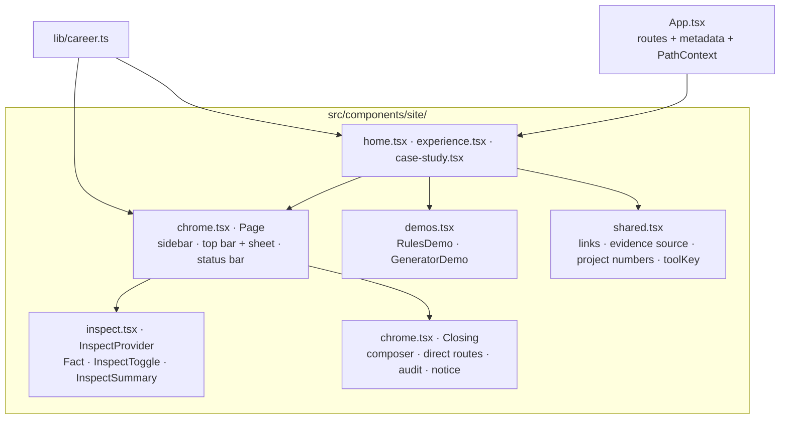

# Portfolio platform architecture

The canonical `/experience/` page combines projects and employment context with professional approach, skills, and education. The former `/about/` page is a compatibility redirect, excluded from the sitemap. Its generated redirect preserves query strings and fragments with JavaScript and includes a no-JavaScript refresh and link. Individual project routes remain available.

## Purpose

This repository is one personal-brand system with three presentation channels:

1. a semantic, prerendered React website;
2. a searchable PDF resume produced with ReportLab;
3. an editable Word resume produced by a dedicated DOCX renderer.

All channels must consume the same schema-validated career record. They can select, order, and format facts for their medium, but cannot maintain separate copies of career history.

## Baseline boundaries

Every page renders inside the workbench frame: a sticky sidebar (from 1024px) with the name, the pages, the outline of the current page, the six projects, "Email me", the resume menu, LinkedIn and GitHub; below 1024px a sticky top bar with the name, the inspector and a menu sheet. With JavaScript a status bar along the bottom of the main column shows the current location, the record the page reads from, the inspector and the theme toggle. The live experience clock was removed at the user’s request; there is no ticking interval or date-duration display.

- Vite 8.x, React 19, strict TypeScript, semantic HTML, and Tailwind CSS v4.
- Static output for Cloudflare Workers Static Assets and the custom domain.
- Free Untitled UI React components (on React Aria) supply buttons and links, utility buttons with tooltips (copy, theme), the resume dropdown, the slide-out menu sheet, tabs, social icons, icons, and theme tokens. The inspector switch is a native toggle button (`aria-pressed`), the composer is a native form, the demos use native inputs and tables, and long detail uses native `
`. Components render to static HTML through React server rendering at build time. The application hydrates after static HTML loads; the Experience page uses React state for project and detail-section selection, with hash links and browser history support. See `UNTITLED-UI.md` for the component inventory and source adaptations.
- `src/components/Portfolio.tsx` is the composition entry; the pages live in `src/components/site/` (see "Workbench redesign" below). Routes retain static content collection reads, route generation, and page metadata. There is no client router or application server.
- Automated validation in the repo covers TypeScript diagnostics, content schemas, production builds, and subpath packaging. Browser, accessibility and performance checks run from the Scrollcraft workspace outside the repo (see `TESTING.md`); no browser test framework is a project dependency.
- The standalone Python resume generator reads the same career JSON and renders PDF and DOCX downloads.

## Project storytelling

Work projects reference a canonical experience ID. The Experience page shows that employer, role, and end customer in the project's detail panel. Independent work has no employer association. Schema validation rejects missing or invalid work-to-experience references.

Career-derived projects are stored beside the canonical career record and rendered through static detail routes. Their challenge, approach, outcome, toolkit, and disclosure fields are schema-validated. The project layer may reorganize documented responsibilities into a clearer narrative, but it cannot invent metrics or expose client-sensitive details.

Independently shareable case-study routes own their page-specific title and description and intentionally omit the site-wide social image when no project-specific primary image exists.

## Design flexibility

The web presentation is the workbench described in `DESIGN_BRIEF.md`: upstream Untitled UI tokens and components on a graphite neutral scale, blue as the one hue (the signal for links, focus, the current place and the primary action), self-hosted Inter and Geist Mono. Layout styles live in `src/styles/global.css`; upstream semantic tokens live in `src/styles/theme.css`. PDF and DOCX generation resolves the light-theme text and brand colors from these same tokens, with Inter and print-specific type sizes.

## Document pipeline

`career.json` → `scripts/generate-resumes.py` → PDF / DOCX downloads

The repository publishes one-page and detailed PDF/DOCX artifacts from the canonical content source through the dedicated resume generator. Web, PDF, and Word may format and select facts differently, but career history remains owned by the shared record. The site has no separate Resume page: the sidebar and overview "Resume" buttons and the contact section's PDF and Word links each open a menu (the phone menu sheet lists both PDFs) to choose the one-page or detailed version (without JavaScript they link to the detailed file), and `/resume/` redirects to the detailed PDF for older links.

Case studies also validate audience, systems, decisions, evidence links, and FDE relevance. Evidence distinguishes user-reported career results from public source code. The portfolio walkthrough documents static rendering and explicitly states that no runtime API or database exists.

Resume generation also regenerates concise/detailed Markdown and job-board plain text to keep downloadable formats aligned. Compact highlights select existing facts; the portfolio project uses its canonical resumeSummary.

### Work explorer presentation

The Experience introduction is followed by a compact credential strip before the professional experience heading. `src/content/credential-images.json` maps canonical credential verification links to the user's exact official Accredible image URLs and verified intrinsic dimensions. The existing content check validates image URLs and canonical references. A responsive grid displays as many previews per row as fit on wide screens and becomes a single swipeable row on narrow screens so the strip stays short before the work; each fixed-height image area uses `object-fit: contain` to preserve the complete badge or certificate. The strip uses ordinary images with alt text, lazy loading and async decoding, and requires no iframe or JavaScript scaling. Readable titles, year-only issue captions and verification links accompany each image. The Learning section shows credential titles, issuers, issue years and verification links. Expiration dates are retained as canonical facts but omitted from the portfolio's own listings and all resume formats; the issuer's unaltered certificate image contains its original issue/expiration details. Static text, images and links remain usable without JavaScript. This presentation mapping is separate from shared career facts and resume generation.

The project selector is a numbered menu (matching the work index's order) beside one detail panel from 1000px, and a scrolling row above it on narrower screens. Embedded case studies show the employer, historical role, dates, and customer once. Three controls group the full content into Overview (problem and results), Implementation (contribution, systems, tools, and walkthrough), and Evidence. Disclosure notes remain visible in all three views. Direct project routes and server-rendered content remain available without JavaScript.

Legacy `/work/` and `/work/<project>/` URLs redirect to the corresponding `/experience/` URLs, preserving query and fragment. `/about/` redirects to `/experience/`. Only canonical Experience routes appear in navigation and the sitemap.

## Workbench redesign (October 30, 2026)

The fourth Scrollcraft build on `NewIU`: the site as a working surface. It replaces the typographic poster (plate, dock, tool trace); that build stays in git history and in the Scrollcraft fingerprint registry.

- **Component organization.** `site/shared.tsx` holds links, the project display name and number, the derived evidence source, the record URL and `toolKey`. `site/chrome.tsx` holds `PathContext`, `Page` (the frame and section tracking), the sidebar, the top bar and its menu sheet, the status bar, `ResumeMenu`, `CopyEmail`, the theme toggle and `Closing` with the composer. `site/inspect.tsx` holds the inspector. `site/demos.tsx` holds the two demonstrations. `site/home.tsx` holds the overview, the work index and project documents, the practice pipeline, the career timeline and the stack matrix, plus the shared `SectionHead`, `CareerSection` and `PipelineFigure`. `Portfolio.tsx` re-exports them and owns the 404 page.
- **The inspector (the signature move).** One boolean in `InspectProvider`, rendered by `Page`. `<Fact path evidence>` wraps a claim in the element it would have been anyway (`span`, `p`, `dd`, `strong`, `div`) and, while the inspector is on, appends a tag with the record path and the evidence; the tag is real text, so screen readers hear it too. The paths are written next to the field they render, so they cannot drift from the text. `InspectSummary` counts `.fact` elements by `data-evidence` and announces the total in a live region. Esc turns it off. Without JavaScript the switch is absent and facts are plain text.
- **Demonstrations.** `RulesDemo` keeps a synthetic claim in state and runs seven checks on every change (required fields, NPI check digit by Luhn over the 80840 prefix, ICD-10 and CPT formats, date order, referral in date, positive amount), marks the failing inputs `aria-invalid`, and drafts the reply from a fixed template. `GeneratorDemo` generates a seeded batch (so the prerendered rows match the first client render), then computes the SHA-256 with `crypto.subtle` and the gzip size with `CompressionStream`. Both prerender their initial state, so the content is readable without JavaScript.
- **Tokens.** `global.css` overrides the upstream `--color-neutral-*` scale with a graphite scale, so every Untitled UI component picks it up, and adds `--wb-*` surface tokens: ground, side, panel, sunken, line, line-strong, ink, ink-2, muted, accent, accent-ink, accent-tint, accent-line, hover, active, dot, chip, pass, flag and their tints, two shadows, the easing and the frame sizes (`--wb-side`, `--wb-status`, `--wb-top`). Dark values are set on `:root.dark-mode`, which also raises `--color-bg-primary` to the panel color and keeps link buttons blue.
- **Layout.** `.wb-main` is a size container named `main`; sections, the overview, the explorer, the pager and the closing respond to `@container main` rather than the viewport, so the sidebar's width never has to be subtracted. Project documents, the flow figure, the demos and the timeline are containers of their own.
- **Motion.** Native CSS in one block at the end of `global.css`: the overview settles on load in a short stagger; project documents, roles, the timeline, the matrix, the audit steps and the composer rise in on a `view()` timeline; timeline bars grow from their start, pipeline connectors draw, and matrix dots settle; inspector tags fade in; the theme switch crossfades through the View Transitions API. All of it is inside `prefers-reduced-motion: no-preference`; scroll-driven parts are also inside `@supports (animation-timeline: view())`.
- **Fonts.** Self-hosted Latin WOFF2 subsets in `src/assets/fonts/` (Inter variable, Geist Mono variable), both preloaded from `index.html`, with local metric-adjusted fallback faces.
- **Scrollcraft hooks.** Sections carry `data-sc-act` with their device name (`surface`, `index`, `document`, `peak`, `pipeline`, `timeline`, `matrix`, `input`) and `Page` adds `html.sc-ready` after mount. They have no runtime effect; they let the skill's harness find the acts.
